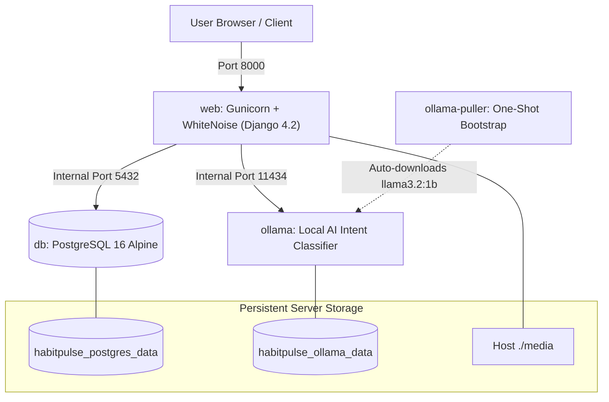

# HabitPulse Docker & Disaster Recovery Guide

This guide explains how to run, backup, restore, and deploy the entire **HabitPulse** application, including all packages, database data, and the local AI intent classification model (Ollama), using Docker.

---

## 1. Quick Start

### Prerequisites
* [Docker Desktop](https://www.docker.com/products/docker-desktop/) or Docker Engine + Compose installed and running.

### Launch Application Stack
```bash
# 1. Start all services (Django Web + PostgreSQL 16 + Ollama AI)
docker compose up -d --build

# 2. View live logs
docker compose logs -f web
```
The application will be live at: **http://localhost:8000** (or port configured in `.env.docker`).

> [!NOTE]
> On the first startup:
> 1. PostgreSQL automatically loads `docker/init_db.sql`. All **10 users**, **9 workspaces**, **10 habits**, and completion history are pre-loaded immediately.
> 2. The `ollama-puller` service automatically downloads the lightweight local AI model `llama3.2:1b` directly into the persistent `habitpulse_ollama_data` volume on your server.

---

## 2. Docker Architecture Overview



* **`web`**: Python 3.10-slim container running Gunicorn WSGI with 3 workers.
  * Managed by `scripts/entrypoint.sh` which ensures PostgreSQL is accepting connections before running non-destructive migrations and compiling static assets with WhiteNoise.
  * Connects directly to `http://ollama:11434` on the isolated internal network.
  * Runs as a secure non-root user `habituser`.
* **`db`**: PostgreSQL 16 container (`postgres:16-alpine`) on internal network with healthchecks.
  * Mounts named volume `habitpulse_postgres_data` for database table persistence.
  * Mounts `./docker/init_db.sql` into `/docker-entrypoint-initdb.d/` for 1-click bootstrap on fresh servers.
* **`ollama`**: Official Ollama container (`ollama/ollama:latest`) running local AI inference for Tier 3 semantic intent classification without external cloud costs.
  * Mounts named volume `habitpulse_ollama_data` to store downloaded models permanently across container updates.
* **`ollama-puller`**: Lightweight one-shot initialization container that auto-fetches `llama3.2:1b` on fresh server spin-up and exits once complete.
* **Storage**:
  * `./media`: User proof uploads & evidence files (bind-mounted from host).
  * `habitpulse_postgres_data`: Persistent database storage (survives container deletion).
  * `habitpulse_ollama_data`: Persistent model weight storage.
  * `./backups`: Exported database and media snapshots.

---

## 3. Ollama AI Model Verification & Diagnostics

To check the Ollama status or verify model connectivity on the server:

```bash
# Check Ollama connection and model status
docker compose exec web python manage.py setup_ollama

# Run a sample AI intent classification test
docker compose exec web python manage.py setup_ollama --test

# Manually trigger a model pull or update
docker compose exec web python manage.py setup_ollama --pull --model llama3.2:1b

# View live Ollama container logs
docker compose logs -f ollama
```

---

## 4. 1-Click Backup & Disaster Recovery

### Create a Complete Snapshot (Database + Media)
Creates a timestamped, compressed database dump and media archive in `./backups/`:

* **On Linux / macOS / Git Bash:**
  ```bash
  chmod +x scripts/backup.sh
  ./scripts/backup.sh
  ```
* **On Windows PowerShell:**
  ```powershell
  .\scripts\backup.ps1
  ```

### Restore on Any Server / Instance
Restores the database state and extracts media files from any timestamped snapshot:

* **On Linux / macOS / Git Bash:**
  ```bash
  chmod +x scripts/restore.sh
  ./scripts/restore.sh 20261107_133000
  ```
* **On Windows PowerShell:**
  ```powershell
  .\scripts\restore.ps1 -BackupFile habitpulse_db_20261107_133000.sql.gz
  ```

---

## 5. Deploying to Any New Server (DigitalOcean, AWS, Linode, Bare Metal)

To migrate HabitPulse to a brand-new cloud server in under 3 minutes:

1. **Install Docker on the server:**
   ```bash
   curl -fsSL https://get.docker.com | sh
   ```
2. **Clone your repository:**
   ```bash
   git clone <YOUR_REPO_URL> HabitPulse
   cd HabitPulse
   ```
3. **Configure environment:**
   ```bash
   cp .env.docker.example .env.docker
   # Update SECRET_KEY, ALLOWED_HOSTS, and CSRF_TRUSTED_ORIGINS for your domain
   nano .env.docker
   ```
4. **Boot the stack:**
   ```bash
   docker compose up -d --build
   ```
   PostgreSQL automatically executes `docker/init_db.sql` on first initialization, and `ollama-puller` ensures the semantic model is ready.

---

## 6. Useful Docker Commands

```bash
# Run test suite inside container
docker compose exec web python manage.py test tests.test_habit_types_and_catalog

# Open Django interactive shell
docker compose exec web python manage.py shell

# Access PostgreSQL CLI
docker compose exec db psql -U habit_user -d habit_tracker

# Stop all containers (without losing database or AI model data)
docker compose down

# View container resource usage
docker stats
```
