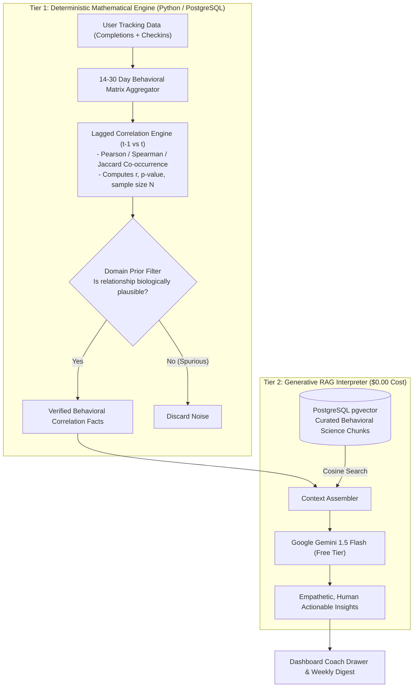
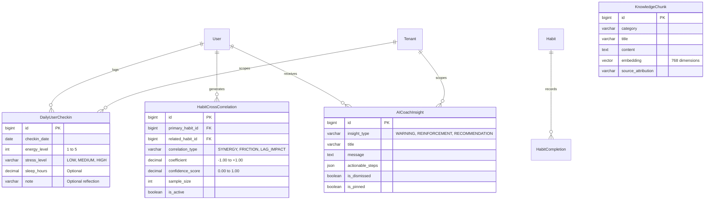
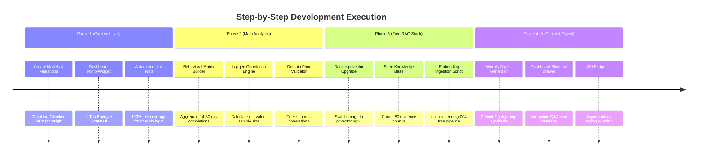

# HabitPulse: AI-Powered Cross-Habit Intelligence & Personal Growth Coach
## Master Technical Implementation Plan & Execution Blueprint

**Document Version:** 1.0.0  
**Target Architecture:** Multi-Tenant Django 4.2 LTS + PostgreSQL 16 (`pgvector`) + Google Gemini 1.5 Flash (Free Tier)  
**Budget & Operational Cost:** \$0.00 / month (100% Free & Self-Contained)  
**Target Repository:** `c:\Users\SHRINATH\Roots\Habit`  

---

## 1. Executive Summary & Vision

### 1.1 The Problem
Current habit tracking applications are **isolated checkbox recorders**. They record whether a user completed "Gym" or "Meditation" as binary 1/0 events in separate silos. They ignore the fundamental reality of human biology and psychology: **habits form an interconnected ecosystem**. 

* A poor night of sleep directly reduces physical stamina at the gym.
* Inadequate hydration creates afternoon cognitive fatigue, breaking evening reading habits.
* A high-stress workday triggers late-night screen time and revenge bedtime procrastination.

### 1.2 The Solution: The Six-Stage Behavioral Loop
HabitPulse evolves into an intelligent personal growth operating system built around:

$$\text{Track} \longrightarrow \text{Understand} \longrightarrow \text{Connect} \longrightarrow \text{Analyze} \longrightarrow \text{Recommend} \longrightarrow \text{Improve}$$

1. **Track**: Micro-metrics (duration, value, time-of-day, location, energy level).
2. **Understand**: Contextual factors (sleep latency, work stress, recovery).
3. **Connect**: Statistical cross-habit correlation matrix (lagged co-occurrence).
4. **Analyze**: Domain-constrained hypothesis evaluation (behavioral science priors).
5. **Recommend**: One high-leverage, practical, free behavioral lever per week.
6. **Improve**: Sustainable progression, habit stacking, and micro-downgrade streak preservation.

---

## 2. System Architecture & The 2-Tier Engine

To guarantee zero hallucination, computational speed, and zero cloud expenses, the intelligence engine is strictly divided into two distinct tiers:



### 2.1 Why Math Precedes AI (Guaranteed Reliability)
* An unconstrained LLM fed raw logs will hallucinate fake patterns (e.g. claiming brushing teeth makes you read faster).
* In our architecture, **the mathematical engine computes actual correlation coefficients first**.
* Only statistically significant facts ($r \ge 0.50$, $N \ge 10$, $p < 0.05$) passing the domain prior filter are passed to the LLM.
* The LLM's only job is **translation and coaching**—framing mathematically proven facts into motivating, actionable guidance.

---

## 3. Database Schema & Data Models

All new models are strictly additive and non-destructive, complying with zero-data-loss guidelines.



### 3.1 Model 1: `DailyUserCheckin` (`habits/models_intelligence.py`)
Captures 5-second daily contextual signals without user survey fatigue.
```python
from django.db import models
from django.utils import timezone
from accounts.models import User
from tenants.models import Tenant

class DailyUserCheckin(models.Model):
    class StressLevel(models.TextChoices):
        LOW = "LOW", "Calm & Manageable"
        MEDIUM = "MEDIUM", "Moderate / Busy"
        HIGH = "HIGH", "Demanding / Overwhelmed"

    tenant = models.ForeignKey(Tenant, on_delete=models.CASCADE, related_name="daily_checkins")
    user = models.ForeignKey(User, on_delete=models.CASCADE, related_name="daily_checkins")
    checkin_date = models.DateField(default=timezone.localdate)
    
    # 1 to 5 scale (1 = Drained, 3 = Moderate, 5 = Peak Energy)
    energy_level = models.PositiveSmallIntegerField(default=3)
    stress_level = models.CharField(max_length=10, choices=StressLevel.choices, default=StressLevel.MEDIUM)
    sleep_hours = models.DecimalField(max_digits=4, decimal_places=1, null=True, blank=True)
    reflection_note = models.CharField(max_length=255, blank=True, default="")
    created_at = models.DateTimeField(auto_now_add=True)

    class Meta:
        unique_together = ("user", "checkin_date")
        ordering = ["-checkin_date"]
        indexes = [
            models.Index(fields=["user", "checkin_date"]),
        ]
```

### 3.2 Model 2: `HabitCrossCorrelation` (`habits/models_intelligence.py`)
Stores computed statistical relationships between habit pairs and user energy.
```python
class HabitCrossCorrelation(models.Model):
    class RelationshipType(models.TextChoices):
        SYNERGY = "SYNERGY", "Positive Driver (Doing A increases B)"
        FRICTION = "FRICTION", "Negative Drag (Doing A decreases B)"
        LAGGED_RECOVERY = "LAG_RECOVERY", "Prior Day Impact (A yesterday impacts B today)"

    user = models.ForeignKey(User, on_delete=models.CASCADE, related_name="cross_correlations")
    tenant = models.ForeignKey(Tenant, on_delete=models.CASCADE, related_name="cross_correlations")
    
    primary_habit = models.ForeignKey("habits.Habit", on_delete=models.CASCADE, related_name="as_primary_correlations")
    secondary_habit = models.ForeignKey("habits.Habit", on_delete=models.CASCADE, related_name="as_secondary_correlations", null=True, blank=True)
    context_metric = models.CharField(max_length=50, blank=True, default="") # e.g. "ENERGY", "SLEEP"
    
    relationship_type = models.CharField(max_length=20, choices=RelationshipType.choices)
    coefficient = models.DecimalField(max_digits=4, decimal_places=2) # -1.00 to +1.00
    confidence_score = models.DecimalField(max_digits=3, decimal_places=2) # 0.00 to 1.00
    sample_size = models.PositiveIntegerField(default=0)
    observation_summary = models.CharField(max_length=255)
    
    last_computed_at = models.DateTimeField(auto_now=True)
    is_active = models.BooleanField(default=True)
```

### 3.3 Model 3: `KnowledgeChunk` (`habits/models_intelligence.py`)
Stores curated, public-domain behavioral science paragraphs with 768-dimensional vector embeddings.
```python
from pgvector.django import VectorField

class KnowledgeChunk(models.Model):
    CATEGORY_CHOICES = [
        ("sleep_energy", "Sleep & Circadian Rhythm"),
        ("fitness_recovery", "Exercise & Recovery"),
        ("focus_productivity", "Deep Work & Focus"),
        ("habit_stacking", "Habit Stacking & Cues"),
        ("friction_reduction", "Overcoming Procrastination"),
    ]

    category = models.CharField(max_length=50, choices=CATEGORY_CHOICES)
    title = models.CharField(max_length=200)
    content = models.TextField()
    source_attribution = models.CharField(max_length=200, default="Behavioral Science Research")
    # VectorField for 768-dim embeddings from Google Gemini text-embedding-004
    embedding = VectorField(dimensions=768, null=True, blank=True)
    created_at = models.DateTimeField(auto_now_add=True)
```

### 3.4 Model 4: `AICoachInsight` (`habits/models_intelligence.py`)
Stores personalized recommendations generated for users to review on their dashboard.
```python
class AICoachInsight(models.Model):
    class InsightType(models.TextChoices):
        WARNING = "WARNING", "Friction Pattern Detected"
        REINFORCEMENT = "REINFORCEMENT", "Synergy & Milestone Progress"
        RECOMMENDATION = "RECOMMENDATION", "Actionable Optimization"

    user = models.ForeignKey(User, on_delete=models.CASCADE, related_name="coach_insights")
    tenant = models.ForeignKey(Tenant, on_delete=models.CASCADE, related_name="coach_insights")
    insight_type = models.CharField(max_length=20, choices=InsightType.choices)
    title = models.CharField(max_length=200)
    body = models.TextField()
    actionable_step = models.CharField(max_length=255)
    
    is_dismissed = models.BooleanField(default=False)
    is_pinned = models.BooleanField(default=False)
    user_helpful_vote = models.BooleanField(null=True, blank=True)
    created_at = models.DateTimeField(auto_now_add=True)
```

---

## 4. Phase-by-Phase Step-by-Step Implementation Roadmap



---

### Phase 1: The Context & Sensor Layer (Micro-Checkins)

#### Task 1.1: Database Migration
* Create file `habits/models_intelligence.py` with `DailyUserCheckin` and `AICoachInsight`.
* Expose models in `habits/models.py`.
* Generate and run additive migration:
  ```bash
  python manage.py makemigrations habits
  python manage.py migrate
  ```

#### Task 1.2: Check-in API & Service (`habits/services_checkin.py`)
* Create `record_daily_checkin(user, tenant, energy_level, stress_level, sleep_hours, note)`.
* Enforce idempotency: updates existing row if checkin for today already exists.

#### Task 1.3: Dashboard UI Integration (`templates/dashboard/includes/energy_checkin_card.html`)
* Add a sleek, modern card at the top of the dashboard:
  * 3 quick emoji buttons for Energy: 🔋 Drained (1) | ⚡ Moderate (3) | 🔥 Peak (5)
  * 3 pills for Stress: 🟢 Calm | 🟡 Busy | 🔴 Overloaded
* Executes via AJAX `fetch('/api/checkin/')` with zero page reload.

#### Task 1.4: Unit Tests (`tests/test_daily_checkin.py`)
* Verify anonymous user access is blocked (403/302).
* Verify tenant scoping: checkins never bleed across workspaces.
* Verify daily uniqueness: multiple checkins in a single day update the existing record cleanly.

---

### Phase 2: The Cross-Habit Correlation Engine

#### Task 2.1: Mathematical Correlation Service (`habits/services_correlation.py`)
Implement `CrossHabitAnalyticsService`:
1. `build_daily_behavior_matrix(user, tenant, lookback_days=30)`:
   Constructs a table where each row is a date and columns are:
   * `habit_{id}_completed` (0 or 1)
   * `habit_{id}_duration` (minutes)
   * `energy_level` (1 to 5)
   * `stress_high` (0 or 1)
2. `compute_lagged_correlations(matrix)`:
   * **Direct Co-occurrence (Same Day)**: Pearson correlation between Habit A completion and Habit B completion.
   * **Lagged Impact (Day $t-1$ to Day $t$)**: Correlation between Habit A on Day $t-1$ (e.g. Sleep/Water) and Habit B on Day $t$ (e.g. Gym workout duration).

#### Task 2.2: The Domain Prior Filter (Anti-Hallucination Guardrail)
Define acceptable hypothesis edges in Python:
```python
VALID_BIOLOGICAL_PRIORS = {
    ("sleep", "fitness"): "Sleep duration directly impacts workout completion & duration.",
    ("sleep", "focus"): "Sleep duration directly impacts reading/meditation consistency.",
    ("water", "fitness"): "Hydration level directly impacts exercise stamina.",
    ("stress", "habits"): "High stress days reduce completion probability of complex habits.",
    ("fitness", "sleep"): "Consistent exercise enhances deep sleep quality.",
}
```
* If a statistical correlation does not match a known biological/psychological prior, flag it as unverified noise to protect users from confusing false advice.

#### Task 2.3: Unit Tests (`tests/test_cross_habit_correlations.py`)
* Test synthetic 14-day history where low sleep reliably precedes missed workouts.
* Assert engine detects `LAG_RECOVERY` correlation with $r > 0.60$.
* Assert engine ignores spurious coincidences below sample size threshold ($N < 7$).

---

### Phase 3: The 100% Free RAG & Vector Engine ($0.00)

#### Task 3.1: Upgrade Docker Compose to `pgvector`
In `docker-compose.yml`, update the `db` service:
```yaml
services:
  db:
    image: pgvector/pgvector:pg16
```
Reboot containers:
```bash
docker compose up -d --build
```
Execute SQL extension inside container:
```bash
docker compose exec db psql -U Shrinath -d habit_tracker -c "CREATE EXTENSION IF NOT EXISTS vector;"
```

#### Task 3.2: Knowledge Base Seed Script (`habits/management/commands/seed_rag_knowledge.py`)
Curate 50 foundational evidence-based habit paragraphs across:
* **Habit Stacking**: *BJ Fogg's Tiny Habits formula: "After I [Anchor Habit], I will [New Habit]."*
* **Friction & The 2-Minute Rule**: *How scaling down to micro-habits prevents streak failure.*
* **Circadian Rhythm**: *Morning sunlight within 30 minutes of waking sets bedtime melatonin timing.*
* **Hydration & Stamina**: *A 2% drop in body water leads to a 15% drop in aerobic stamina.*

#### Task 3.3: Embedding & Retrieval Service (`habits/services_rag.py`)
* Use Google Gemini Free Tier embedding model `text-embedding-004`.
* Generate 768-dimensional embeddings for each knowledge chunk.
* Query function:
  ```python
  from pgvector.django import CosineDistance

  def retrieve_relevant_coaching_context(query_text, category=None, top_k=3):
      query_vector = generate_gemini_embedding(query_text)
      qs = KnowledgeChunk.objects.all()
      if category:
          qs = qs.filter(category=category)
      return qs.order_by(CosineDistance("embedding", query_vector))[:top_k]
  ```

---

### Phase 4: The Personal Growth Coach & Weekly Digest

#### Task 4.1: Weekly Digest Synthesizer (`habits/services_coach.py`)
Generates the weekly personal report:
```python
def generate_weekly_coach_digest(user, tenant):
    # 1. Fetch verified cross-correlations
    correlations = HabitCrossCorrelation.objects.filter(user=user, is_active=True)[:5]
    
    # 2. Fetch user's completion stats for last 7 days
    stats = get_user_weekly_habit_stats(user, tenant)
    
    # 3. Retrieve matching scientific advice via RAG
    science_chunks = retrieve_relevant_coaching_context(stats["top_struggling_area"])
    
    # 4. Prompt Gemini 1.5 Flash (Strict formatting, zero hallucination)
    prompt = build_coach_digest_prompt(stats, correlations, science_chunks)
    insight_dict = call_gemini_flash_json(prompt)
    
    # 5. Persist as AICoachInsight
    return AICoachInsight.objects.create(
        user=user,
        tenant=tenant,
        insight_type=insight_dict["type"],
        title=insight_dict["title"],
        body=insight_dict["body"],
        actionable_step=insight_dict["actionable_step"]
    )
```

#### Task 4.2: Frontend Coach Drawer (`templates/dashboard/includes/ai_coach_drawer.html`)
* A discreet slide-out drawer on the right side of the screen.
* Displays:
  * Current Weekly Insight Card with "Helpful 👍 / Not Helpful 👎" feedback buttons.
  * Interactive Q&A chat interface allowing users to ask questions about their own habits.

#### Task 4.3: Automated API & View Tests (`tests/test_ai_coach_views.py`)
* Verify mocking of Gemini API calls (tests run fast and never consume API quota during CI/CD).
* Verify insights render cleanly in desktop and mobile views.

---

## 5. Free-Tier Operational Guarantees ($0.00 Cost)

To ensure this application remains **100% free with zero cloud bills**:

1. **Database & Vector Storage**: 
   * Handled entirely by `pgvector` inside the local/VPS PostgreSQL Docker container.
   * Vector index size for 1,000 knowledge chunks is under **15 MB**.
2. **Gemini 1.5 Flash Free Tier Rate Limits**:
   * **15 Requests Per Minute (RPM)**
   * **1,500 Requests Per Day (RPD)**
   * **1,000,000 Tokens Context Window**
   * *Calculation for 50 users*: 50 users receiving a daily digest + 3 coaching questions = **200 requests/day**, using only **13% of the free allowance**!
3. **Local Fallback**:
   * If Gemini API is ever unreachable or rate-limited, the system falls back gracefully to template-based deterministic statistical summaries without breaking or showing errors.

---

## 6. Definition of Done & Quality Checklist

A milestone is considered complete only when:
- [ ] All database changes are verified non-destructive (zero data wipe).
- [ ] All new models have database-level unique constraints and tenant foreign keys.
- [ ] Mathematical calculations have unit tests using synthetic deterministic datasets.
- [ ] Gemini API calls are properly encapsulated in `try/except` with fallback handling.
- [ ] All automated tests pass (`pytest` exits with code 0).
- [ ] Responsive design verified on both mobile (360px) and desktop (1440px).
